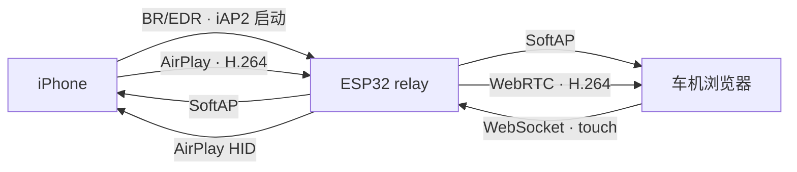

# ESP32 CarPlay Web Relay

[](https://github.com/xujingguo58/esp32-carplay-web-relay/actions/workflows/ci.yml)
[](LICENSE)

基于 ESP-IDF 的实验性无线 CarPlay 接收与网页中转项目。协议实现参考 [DiPlay / xcertplay](https://github.com/shihabal3amri/DiPlay)，浏览器媒体和触控路径参考 [WheelPlay](https://github.com/fython/wheelplay)。

> **项目状态：**M2 浏览器样机及 M3–M5 协议代码持续完善中；ESP-IDF 5.5.3 的经典 ESP32 固件已构建通过。项目尚未在 ESP32 开发板、iPhone 和目标车机浏览器上完成端到端实测，当前代码不代表已成功建立真实 CarPlay 连接。

## 工作流程



网页由 ESP32 的 HTTP 服务提供；WebSocket 用于会话信令和触控消息，实时视频通过 WebRTC 转发。设计目标是直接转发 H.264，避免在 ESP32 上解码或转码。

## 实现进度

| 阶段 | 已有代码 | 尚待验证 |
| --- | --- | --- |
| M1：平台骨架 | SoftAP、HTTP 状态页、BR/EDR/RFCOMM 适配 | 开发板热点、蓝牙及共存行为 |
| M2：浏览器样机 | 合成 H.264、WebRTC、WebSocket 信令、触控回显 | 目标浏览器播放、实机资源与延迟 |
| M3：协议核心 | iAP2 状态机、MFi signer 接口、无线启动消息 | iPhone 蓝牙发现、认证和会话启动 |
| M4：视频接收 | RTSP 配对、Screen DataStream 解密/组帧、WebRTC 媒体桥 | 真实 CarPlay 视频、持续播放和重连 |
| M5：触控回传 | 触点映射、HID/Event Control 软件路径、断连清理 | iPhone 端 down/move/up 及释放行为 |

运行中的 M2 固件发送的是**合成测试图像**，并会在网页标明它不是 CarPlay 画面。每次启动的网页配对码只通过 UART 输出；未完成配对时不会启动 WebRTC。各阶段实现和验收记录见 [开发路线图](docs/ROADMAP.md)。

## 快速开始

### 硬件与软件

- 目标芯片为支持 Bluetooth BR/EDR 的经典 ESP32；ESP32-S3、ESP32-C5 等仅支持 BLE 的芯片不能替代该蓝牙链路。
- 推荐使用带 PSRAM 的模组。8 MB Flash profile 是当前推荐配置；4 MB profile 也可构建，2 MB 分区不足以容纳当前固件。Flash 容量不等于 PSRAM 容量。
- 需要 ESP-IDF 5.5.3，并在已加载 ESP-IDF 环境的终端中运行命令。

### 配置和构建 8 MB profile

```sh
export IDF_TARGET=esp32
export SDKCONFIG_DEFAULTS="$PWD/sdkconfig.defaults.8mb"

idf.py -B build-8mb -D SDKCONFIG="$PWD/sdkconfig.8mb" menuconfig
idf.py -B build-8mb -D SDKCONFIG="$PWD/sdkconfig.8mb" build
```

在 `CarPlay Relay → SoftAP` 中设置 SSID 和 WPA2 密码（8–63 个字符）。配置保存在本地 `sdkconfig.8mb`，该文件不会提交到仓库。

烧录时使用同一个 profile，并将串口路径替换为开发板对应端口：

```sh
idf.py -B build-8mb -D SDKCONFIG="$PWD/sdkconfig.8mb" -p /dev/cu.usbserial-XXXX flash monitor
```

设备启动后，连接 ESP32 SoftAP，浏览器访问 <http://192.168.4.1/>，输入本次启动时 UART 输出的网页配对码。`GET /api/status` 可查看 AP、客户端、内部堆/PSRAM 余量和媒体丢帧统计。

8 MB profile 使用单个应用分区，不包含 OTA 或文件系统分区。4 MB 与 8 MB 分区布局和构建选项见 [架构设计](docs/ARCHITECTURE.md)。

## 检查

在加载 ESP-IDF 5.5.3，并安装 Clang 和 Node.js 后，运行与 GitHub Actions 相同的构建和主机检查：

```sh
sh tools/ci.sh
```

部分协议检查会构建 ESP-IDF 随附的 Mbed TLS，并依赖 `IDF_PATH`。自动化检查不能替代蓝牙、热点、iPhone、真实视频或触控的硬件验收。详见 [贡献指南](CONTRIBUTING.md)。

## 项目结构

- `components/net_port/`、`bt_port/`、`iap2_*`：SoftAP、Bluetooth BR/EDR 和 iAP2 启动链路。
- `components/airplay_*`：AirPlay 配对、RTSP、媒体接收、事件通道和 HID 控制。
- `components/web_gateway/`、`media_bridge/`、`input_bridge/`：网页信令、WebRTC 媒体及触控映射。
- `docs/`：架构、开发路线图和验收记录；`tools/`：合成媒体及主机检查。

DiPlay、WheelPlay 等上游参考源码位于工程旁的 `esp32-reference/`，不会作为固件依赖；组件和来源说明见 [第三方声明](THIRD_PARTY_NOTICES.md)。

## 身份材料与安全说明

- iAP2 MFi challenge-response 由软件 signer 完成，不需要外置 MFi 芯片。仓库中的 P-256 私钥和证书来自 DiPlay v0.2.21 官方 APK，是实验身份材料，不是为本项目签发的 Apple 认证身份，也不保证未来 iOS 会接受。私钥编入固件后可从镜像提取，来源和限制见 [MFi 身份声明](components/auth_software_provider/IDENTITY_NOTICE.md)。
- AirPlay Ed25519 身份首次启动时生成并保存到 NVS；当前未启用 Flash/NVS 加密，接触设备的人可能提取身份。Pair-Setup 默认使用开发配对码 `3939`，可通过 Kconfig 修改。详见 [AirPlay 身份声明](components/airplay_software_provider/IDENTITY_NOTICE.md)。
- 网页配对码通过 UART 输出；当前开发服务不提供 TLS，也不适合作为产品级 provisioning 方案。

使用和分发本项目时，请遵守 GPL-3.0 及依赖许可要求。参见 [许可证](LICENSE)、[安全策略](SECURITY.md) 和 [变更记录](CHANGELOG.md)。
