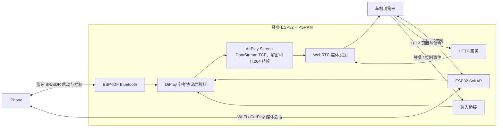

# 架构设计

## 1. 目标与边界

本项目把 CarPlay 接收端和浏览器展示端合并到 ESP32：ESP32 创建热点，完成 iPhone 无线接入和 CarPlay 会话；车机浏览器从同一局域网访问网页，接收画面并回传触摸。

方案参考：

- **DiPlay / xcertplay：**CarPlay 接收、蓝牙启动、iAP2、认证、AirPlay 会话和媒体处理。其共享代码目录覆盖协议与媒体实现，整体应用则包含 Android 平台代码。[工程结构](https://github.com/shihabal3amri/DiPlay/blob/main/docs/UPSTREAM-README.zh-CN.md)
- **WheelPlay：**浏览器配对、Web 服务、媒体发送、触摸和状态 UI。项目说明支持 WebRTC H.264/HEVC 直通与 JPEG 兼容模式；WebRTC 使用 ESP32 不应直接照搬 Android 原生实现，而应评估 ESP-IDF 的 `esp_peer`。[WheelPlay](https://github.com/fython/wheelplay)、[ESP Peer](https://github.com/espressif/esp-webrtc-solution/tree/main/components/esp_peer)

本设计的首版范围假设为：无线 CarPlay、单台 iPhone、单个浏览器客户端、H.264 画面直通和触摸回传。音频、麦克风、通话/Siri、HEVC、USB 有线 CarPlay 暂不纳入首版验收。

当前工程已有 `net_port`、`web_gateway`、`media_bridge`、`bt_port`、`iap2_core`、`iap2_identity`、`iap2_carplay`、`iap2_mfi_auth`、`auth_port`、`auth_software_provider`、`airplay_identity_port`、`airplay_software_provider`、`ed25519`、`airplay_pairing_store`、`airplay_screen`、`airplay_media_bridge`、`airplay_rtsp`、`airplay_pairing`、`airplay_control`、`airplay_session`、`airplay_timing`、`input_bridge` 与 `time_port` 组件。浏览器 WebRTC 使用合成 H.264 的 M2 样机代码；蓝牙/iAP2 当前属于启动基础；`iap2_carplay` 按 DiPlay 的字段映射构造含可选 BSSID 的 `0x5703`，并编码无线组、AirPlay 端口、公钥和版本字符串组成的 `0x4301` CSM body。iAP2 识别收到 `0x1d03` 时，若拒绝内容仅涉及合法的不支持消息列表，会过滤这些 ID 并重发一次 IdentificationInformation。已接入条件运行路径：有效 identity provider、RTSP listener 和 mDNS 广告均启动成功后，认证通过并收到 `0x4300` 才发送 `0x4301`。启动时 `auth_software_provider` 解析内嵌 PKCS#8 私钥与 PKCS#7 证书、校验匹配并注册 MFi challenge signer；默认 AirPlay provider 首次启动时生成独立 Ed25519 receiver identity，保存在 NVS，并提供 Pair-Setup/Verify callbacks、`/info` plist 和 mDNS TXT。一次较早的实机连接日志已到 AirPlay Pair-Setup、Pair-Verify 和 MFi auth-setup；蓝牙设置可见性、当前源码的 mDNS/RTSP 行为及完整 CarPlay 视频仍待新固件复测。`airplay_screen` 负责 Screen DataStream 接收、解密及按 DiPlay 规则派生输出密钥，`airplay_media_bridge` 将解密配置和帧映射到 WebRTC 发送接口；`tools/test_airplay_screen_stream_host.sh` 将 AEAD 测试帧经实际 Screen 回调和媒体适配器送到替身 `media_bridge` API，验证 `avcC`/SPS/PPS、Annex-B access unit、时间戳以及坏 tag 不提交帧；`tools/test_airplay_media_bridge_host.sh` 另测适配器参数和消息类型。这证明到 WebRTC API 边界的软件路径，不代表 `esp_peer` 真实发送。`airplay_rtsp` 提供有界 framing、binary plist 子集和配对路由；`airplay_pairing` 提供限长 TLV8、SRP-6a、配对状态机和 provider 回调；`airplay_session` 提供 RTSP 路由、ControlCipher 切换、`/info`、最多遍历 8 项的 streams SETUP（仅启动主屏 type 110）、RECORD/TEARDOWN 与 SoftAP IPv4 TCP listener。初始 SETUP 启动 UDP timing 和 Event listener 并返回端口；`airplay_timing` 记录 RTT/时钟偏差但暂不校正媒体时间；`airplay_control` 提供事件通道加密、HID 命令和请求应答。真实 Screen 视频和浏览器连续播放尚未验证。

RTSP 控制、Event TCP 和 Timing UDP 由同一 RTSP server task 的 `select()` 轮询，不再为 Event 或 Timing 单独创建 FreeRTOS 任务。Event listener 状态及 1200 字节接收区优先分配到 PSRAM；这取消了 Event 固定 4 KB 的独立内部任务栈。合并后的 Event 解密/收发会使用 RTSP task 的 10 KB 内部栈，设备端需检查该任务高水位及连续会话稳定性后，才能确认运行时余量。

`airplay_pairing_store` 是 NVS controller 配对记录适配器。`app_main` 在 NVS 初始化后准备该组件，再调用可选 provider 注册钩子；若钩子没有注册 AirPlay provider，则加载 `airplay_software_provider`。provider 将 `airplay_pairing_store_save_callback` 和 `airplay_pairing_store_lookup_callback` 分别接到 Pair-Setup 与 Pair-Verify。controller store 最多保存 8 条、标识最多 64 字节的公钥记录。AirPlay receiver 的 Ed25519 seed 与随机 pairing ID 独立保存于 `airplay_id` NVS namespace；未启用 Flash/NVS encryption 时可通过物理访问提取。NVS 记录损坏时查询失败关闭。`time_port` 汇总 ESP-IDF 单调微秒/毫秒时钟，供协议超时、触点超时、timing packet 和媒体时间戳使用；它不提供墙上时钟或证书有效期判断。

## 2. 逻辑架构

## 3. 模块职责

### 3.1 网络与无线接入 `net_port`

- 启动 WPA2 SoftAP、DHCP 和本地 IP 服务；首选固定访问地址，网页可显示二维码或连接信息。
- 同时容纳 iPhone 与车机浏览器，确保客户端之间能够访问 ESP32 服务。
- 首版使用同一热点/同一局域网模式；暂不移植 Android Wi-Fi Direct API。
- 在 SoftAP 接口上发布 CarPlay 所需的本地发现服务；HTTP 页面可通过固定 IP 访问，`.local` 名称作为可选功能。
- 配置网络隔离策略，只开放页面、信令、媒体和必要的本地服务，不提供无关外网转发。

### 3.2 Bluetooth BR/EDR `bt_port`

- 使用经典 ESP32 的 Bluetooth BR/EDR 能力承接 iPhone 蓝牙启动流程。
- 将 DiPlay 中 Android 蓝牙 socket、配对和服务发现调用替换为 ESP-IDF Bluetooth 接口。
- 为 iAP2 传输提供 RFCOMM 通道及可靠的连接、超时、重连和断开事件。
- `bt_port` 作为 BR/EDR 客户端发现 iPhone、查询对端 iAP2 SDP UUID 并连接其 RFCOMM 服务；本机名称、Audio/Video Car Audio Class of Device 和 EIR 名称均已配置。只有浏览器媒体就绪时，本机才进入 connectable/general-discoverable 并启动 iPhone inquiry；断开网页后停止发现并隐藏本机。主机测试验证了门控调用、CoD 和 EIR 参数，iPhone 实机可见性、配对、RFCOMM 行为及与 SoftAP 并发仍待板上验证。
- RFCOMM 接收回调和 iAP2 worker 之间使用有界队列；任一级队列发生 RX 数据溢出时立即断开该 RFCOMM 会话，避免在已丢字节的 iAP2 流上继续解析。状态事件会优先于旧 RX 队列内容送达，以便 worker 清理并重置认证状态。

### 3.3 CarPlay 协议层 `cp_core`

从 DiPlay/xcertplay 提取平台无关逻辑，逐步移植为 ESP-IDF 可构建的 C/C++ 组件：

- iAP2 帧解析、状态机、可靠传输和会话管理。
- 认证挑战处理和认证资源接口。
- 无线 Wi-Fi 会话启动、服务发现、AirPlay/RTSP 协商。
- 媒体流密钥/加密处理、会话断开和重连。
- HID/触摸输入报告生成。

Android `Activity`、`BluetoothSocket`、`WifiP2pManager`、`MediaCodec`、`AudioTrack`、`Surface`、Android 持久化等不属于可直接移植的协议核心，需要以 ESP-IDF 或浏览器侧能力替换。

当前 `iap2_carplay` 已按 DiPlay 的 CSM schema 构造 `0x5703`（可含 SoftAP BSSID）和 `0x4301`（wireless 组、AirPlay 端口、device identifier、公钥、sourceVersion），并通过主机 ASan/UBSan 检查。`0x5703` 已由 RFCOMM 消息处理调用；`0x4301` 条件发送路径读取 SoftAP IPv4 与实际 RTSP listener 端口。`airplay_identity_port` 接收 AirPlay 配对配置、binary `/info`、iAP2 endpoint identity 和 `_airplay._tcp` TXT metadata；`app_register_deployment_providers()` 可替换默认 provider。若没有部署 provider 覆盖，启动流程注册默认软件 provider；认证、identity provider、RTSP listener 或 mDNS 广告未就绪时仍不会发送 `0x4301`。

`iap2_core` 把本端最大未确认发送窗口限制为 1；接收端依据对端 SYNC 通告的 `maxOutgoing` 识别有序包和序号缺口。缺口时发送 iAP2 扩展 ACK，列出未缓存的缺失范围（包括当前乱序包），并在收到对端扩展 ACK 时立即重传匹配的未确认包；常规累计 ACK 与原有重传超时仍有效。只有纯 `0x40` ACK 帧的 payload 才送入 CSM 解析，组合 ACK/扩展 ACK 保持为链路控制。8 位序号按模 256 回绕；链路进入 READY 后重复 SYNC 只记为坏帧，不改写当前接收序号。`tools/test_iap2_core_host.sh` 使用 ASan/UBSan 覆盖缺口恢复、序号回绕、控制位组合隔离和重复 SYNC；由于 RFCOMM 自身为可靠有序传输，真实 iPhone 链路 trace 与蓝牙共存行为仍需硬件验证。

`bt_port` 在自身 RX 队列或上层 iAP2 事件队列满时会关闭当前 RFCOMM 连接并清空待处理 RX，避免丢块后继续处理不完整的协议字节流；断连状态事件会清理 iAP2、MFi 与无线会话状态。`tools/test_bt_port_host.sh` 直接编译适配器并模拟同步 SPP 回调，覆盖 Car Audio CoD/EIR 设置、浏览器就绪时的可发现性门控，以及本地 RX 队列溢出后的 disconnect、清队列和断连事件优先级；它不模拟 ESP-IDF GAP/SPP 无线行为或 FreeRTOS 队列调度，相关压力仍需硬件验证。

`iap2_mfi_auth` 将 `0xaa05` 成功通知限制在本 RFCOMM 会话中的 provider 签名 `0xaa02` challenge 响应 `0xaa03` 被 iAP2 对端在 link 层确认之后。仅被 RFCOMM 接口接受、进入 iAP2 发送队列或尚未收到 ACK 的帧不推进状态。即使 ACK 和 `0xaa05` 位于同一个对端 link frame，核心也先处理 ACK callback，再分发 CSM payload。`0xaa04`、iAP2 link 进入 DEAD、RFCOMM 断开或重连会重置认证阶段；主机测试覆盖越级成功拒绝、等待 ACK、piggyback 顺序、失败与重置。`iap2_identity` 也解析受限的 `0x1d03` 消息列表拒绝；不支持的认证消息或其他身份参数不会触发兼容重试。

### 3.4 媒体接收与桥接 `media_bridge`

`test_airplay_screen_stream_host.sh` 以 IDF 随附的 Mbed TLS 构造并解密 Screen AEAD 视频帧，再经实际 `airplay_media_bridge_on_screen_message` 回调提交给替身 `media_bridge` API；它检查 `avcC` SPS/PPS、Annex-B 视频 access unit、AirPlay sender/本地到达时间，以及坏 tag 不推进计数器、不提交媒体帧。该测试覆盖 Screen 解密到 WebRTC 发送 API 边界的软件路径，不执行真实 `esp_peer` 发送。AEAD 校验失败会关闭当前 TCP DataStream，并结束所属 RTSP 会话。

视频路径按 DiPlay 当前实现的 CarPlay Screen DataStream 处理，不假设视频是 RTP：

1. AirPlay RTSP `SETUP` 为 Screen DataStream 返回 TCP 端口，协商得到 stream connection ID 和输出密钥。
2. 读取每条消息的 128 字节头：body 长度为偏移 0 的小端 32 位值，opcode 在偏移 4（0 为视频帧、1 为配置），发送端 32.32 NTP 时间在偏移 8。
3. 配置消息中解析带 `avcC` FourCC 的配置 atom，或 DiPlay 兼容路径中的裸 AVCDecoderConfigurationRecord，提取并校验 SPS/PPS 后转成 Annex-B；显式 `hvcC` 配置在当前 H.264-only 范围内拒绝。视频帧以 4 字节长度前缀承载 NAL。
4. 视频帧使用 DataStream 输出密钥和 ChaCha20-Poly1305 解密，nonce 为 4 字节零加 8 字节小端帧计数，128 字节头作为 AAD，帧体末尾 16 字节为认证标签。
5. H.264 access unit 和时间戳进入 `media_bridge` 的 `esp_peer` WebRTC H.264 发送接口；优先使用 AirPlay sender 时间构造会话相对 90 kHz PTS。sender 时间缺失或回退后，使用到达时间并保持时间轴不倒退；浏览器侧负责解码，ESP32 不承担视频解码和重编码。

代码现状：`airplay_screen` 已实现上述数据消息头校验、单连接 TCP listener、ChaCha20-Poly1305 解密、带 `avcC` 标记或裸 AVCDecoderConfigurationRecord 的 SPS/PPS 提取、长度前缀转 Annex-B，以及 HKDF-SHA512 输出密钥派生。Screen body 上限为 8 MiB（含 tag），RX 缓冲按 TCP 收包量增长并预留 4 KiB 前缀；扩容或分配域迁移时保留已经收到的字节。视频在同一缓冲内原位解密并转换为 Annex-B，避免第二份明文分配。WebRTC 单帧队列借用 RX access unit 直到 `esp_peer_send_video()` 返回；IDR 的 SPS/PPS 写在前缀里，帧数据不搬移，接收任务在单帧队列满时等待发送结果，因此不会无限积累整帧。应用层不再为媒体桥分配第二份整帧 staging buffer，也不再逐帧复制；`esp_peer` RTP 发送池仍有自己的缓冲开销。默认和 4 MB profile 未启用 SPIRAM；8 MB Flash 调试 profile 已启用 40 MHz PSRAM 自动检测，并将 mbedTLS 工作分配放入 PSRAM，允许无 PSRAM 时继续启动，但没有 PSRAM 时 WebRTC peer 仍可能无法建立。当前 8 MB profile 要求经典 ESP32 Rev 3.0 或更新版本。主机测试覆盖 600 KiB AEAD access unit 的原位解密、时间戳、坏 tag、适配器指针借用与 IDR 前缀写入，但不模拟 ESP32 PSRAM 碎片或真实 WebRTC 峰值。`airplay_media_bridge` 将解密帧接入媒体桥；`media_timestamp` 优先使用 AirPlay sender 时间构造会话相对 90 kHz PTS，失效或回退时切换到到达时间。RTSP 实现 Pair-Setup/Verify、ControlCipher、`/info`、有界 streams SETUP、RECORD/TEARDOWN；初始 SETUP 启动 Event 和 UDP timing listener。Mbed TLS 承担 SRP-6a、X25519、HKDF 和 ChaCha20-Poly1305；Pair-Verify 派生 Control/Event 密钥。默认 `airplay_software_provider` 使用随机 NVS seed 与 UUID 派生 Ed25519 身份，提供 Pair-Setup/Verify 签名/验签、NVS controller 存储、`/info` 和 mDNS TXT。Provider 和启动路径已有构建/主机测试，但实际 mDNS、iPhone 配对、H.264 接收及 `esp_peer` 浏览器发送仍待板卡验证。

RTSP server 将最大 3.5 KB 的 `/info` plist 从 server 结构体中分离，先申请 PSRAM、失败后回退 internal；该 RTSP server 持有缓冲，所创建 session 以明确的 borrowed-info API 共用只读数据。独立 session API 仍默认复制输入数据，保持原生命周期契约。每个 RTSP connection 的 1200 字节接收 scratch 放在已有 PSRAM 优先分配的 connection 对象中，降低 RTSP task 的实际栈使用；任务本身仍创建 10 KB internal stack，因此不计为已释放的 internal heap。`rtsp_listener`/`rtsp_connection` 日志报告 plist 和 connection 的实际分配域。2026-10-23 实机确认 Event state 位于 PSRAM、Event/Timing listener 均启动且 iPhone 已接入 Event；旧门槛拒绝 RECORD 后 RTSP task 栈高水位为 2084 字节，WebRTC 保持连接时内部堆剩余约 26 KB。该结果尚未覆盖真实视频负载。`RECORD` 按 DiPlay 的会话激活语义处理：成功完成初始 Event/Timing SETUP 或 Screen SETUP 后即可返回 200；初始 SETUP 后允许先 RECORD、再建立 Screen 流。日志以 `phase=awaiting_screen_setup`/`screen_ready` 区分会话激活与屏幕监听就绪，两者都不代表已经收到真实视频。完全未 SETUP 或完整 TEARDOWN 后的 RECORD 返回 503。主机 session ASan/UBSan 测试覆盖该顺序、重复 RECORD、后续 Screen SETUP 及 TEARDOWN 后拒绝。

RTSP server、session、Pair-Setup、Pair-Verify、SRP 和 pairing wrapper 等长期会话状态显式采用 PSRAM 优先、internal 回退的分配器。8 MB ESP-IDF ELF 的 DWARF 类型大小分别为 128、208、372、460、132 和 8 字节，合计 1308 字节，约 1.3 KiB；先前外部分析将 RTSP server/session 估成约 7.3 KiB，和实际类型大小不符。Event/Timing 旧日志中的 `stopped_semaphore`、`task_create_failed` 属于此前仍有独立 listener task 的固件；当前源代码不创建这些对象。旧日志能证明当时 internal 堆余量很低且最大连续块很小，但不能证明当前固件仍在同一失败点，也不能单凭两次空闲堆快照把全部下降归因于 `esp_peer`。新分配策略和 Classic-only 配置已通过构建；运行时 internal heap 收益、RTSP 高水位和真实 AirPlay SETUP 仍需实机测量。

默认、4 MB 和 8 MB profiles 仅使用 Classic BR/EDR、iAP2/SPP，不调用 BLE/GATT；配置关闭 BLE host，保留 Classic 安全配对。硬件扫描、iPhone 配对及 iAP2 链路需要新固件实测确认。

Event listener 的非预期退出会将当前 Event 通道标为失败并禁用触控，RTSP 会话继续；同一 RTSP/Pair-Verify 会话中最多使用一次 Event 密钥。TEARDOWN 停止已连接的 Event 通道后，不允许在同一会话内重新打开通道，客户端需要建立新会话取得新密钥，以免 ControlCipher 计数器从零开始后复用 AEAD nonce。

`media_bridge` 的 AirPlay 输入在提交 H.264 帧时登记一个活动生产者；生产者持有 Screen RX 缓冲的借用引用，直到 WebRTC 任务调用 `esp_peer_send_video()` 返回。WebRTC 任务停止时先关闭提交入口，拒绝或排空已入队帧并唤醒等待的生产者，确认活动引用离开后再销毁队列，避免浏览器断连与 Screen DataStream 接收并发时访问已释放资源。`media_keyframe_gate` 在启动、参数集变更、PLI、断连或任意媒体帧丢失后等待 IDR；只有 IDR 成功提交给 `esp_peer` 后才恢复发送依赖帧。实际帧丢失或发送失败时，桥接会向在线 iPhone 请求新的 IDR；浏览器触发 WebRTC PLI 时也会发送 DiPlay `forceKeyFrame` 主屏命令。命令通过加密 AirPlay Event 连接发送，并按会话限频 250 ms；`test_airplay_control_cipher_host.sh` 解密并验证 RTSP 方法、CSeq、无 stream ID、plist 内容和限频行为，`test_touch_hid_bridge_host.sh` 另验证固定 plist 编码。`tools/test_media_frame_gate_host.sh` 用 ASan/UBSan 与 pthread 交错执行活动提交和停止，并检查丢帧后的关键帧恢复策略、借用帧前缀准备：停止关闭入口、后续提交被拒绝、已有提交离开后才报告排空；丢失引用帧后 P 帧被丢弃，直到 IDR 成功发送。该主机测试验证同步和恢复状态策略，不替代 ESP32/FreeRTOS 压力实测或浏览器解码验证。

WebRTC answer SDP 的单槽队列只保存缓冲指针和长度；SDP 本体单独申请 PSRAM，失败时回退内部堆，发送完成或队列清理时擦除并释放。此前队列项和 `webrtc_peer` 任务局部变量各内嵌 3 KiB SDP 数组；新路径去掉内部队列中的大块常驻数据及任务中的固定 SDP 数组，降低 WebRTC 建连时的内部堆压力和任务栈峰值。任务仍保留 16 KiB 内部栈：历史实测曾发生 `webrtc_peer` 栈溢出，后续需在设备完成 ICE/DTLS 和实际媒体收发后依据 high-water 数据再决定缩栈；当前日志快照不能证明新配置的运行时余量。

首版只承诺 H.264。WheelPlay 支持 HEVC，但 Espressif `esp_peer` 公开接口列出的媒体格式包括 H.264、MJPEG 和音频格式，没有把 HEVC 作为本项目首版依赖。[ESP Peer 媒体能力](https://github.com/espressif/esp-webrtc-solution/tree/main/components/esp_peer)

`esp_peer` 发送队列与缓冲池有上限；发送失败会统计丢帧并等待关键帧。接收端到浏览器的 WebRTC packetization、H.264 profile/level 和参数集兼容性需要实机验证。

### 3.5 Web 服务与网页 `web_gateway`

- ESP HTTP 服务当前提供单页样机、状态 API 和 `/ws` WebSocket 信令/触控；`GET /` 和 `GET /api/status` 已落地。状态 API 报告当前及启动以来最低内部堆/PSRAM 余量。
- 当前 `/ws` 限制单个媒体浏览器，并要求输入网页配对码；调试构建固定使用 `11111111`，只打印到 UART，不由网页或状态 API 暴露。五次错误后锁定 30 秒。入站消息按 120 消息/秒、120 条突发额度限流，超限会释放触点并关闭连接。尚无 TLS 或产品级配对码 provisioning，服务仅供设置了 WPA2 密码的开发 SoftAP 使用。
- 网页以 `RTCPeerConnection` 接收 H.264 视频；SDP/ICE 信令和触控事件使用已配对的 WebSocket。当前不启用 WebRTC DataChannel，以减少 ESP32 的运行时内存占用。
- SDP answer 仅在所有 ESP Peer offer 的 `a=setup` 字段都是 `actpass` 时将浏览器的 `active` answer 改成 `passive`；active、passive、混合或缺少角色的 offer 保留 WebRTC 自己生成的 answer。`node tools/test_web_gateway_page.mjs` 从固件实际内嵌 HTML 提取整页脚本检查语法，并测试该角色选择 helper；仍需目标浏览器与 ESP32 的 DTLS 实际协商。
- 网页静态资源放入只读文件系统或固件资源分区，并启用压缩。
- 当前只限制单个浏览器媒体会话；配对码随设备重启更新，浏览器不持久化配对码。不要在不受信任的网络上开放服务。

HTTP 是网页和信令入口；低延迟视频由 WebRTC 承载。不要把 WebRTC 视频误画成普通 HTTP 文件下载。JPEG over HTTP 可作为未来兼容模式，但它要求产生 JPEG 帧，首版不在 ESP32 上实现 H.264 解码/转码。

### 3.6 触控输入 `input_bridge` 与 AirPlay 控制加密

Event Control 传输断开时，`airplay_rtsp_server` 调用 `web_gateway_release_touches()`，将释放操作排入 HTTPD work queue，由 HTTP server task 串行访问 `input_bridge`。若队列暂满，pending 标记由下一次 250 ms 看门狗工作消费。此时远端 event socket 已关闭，回调只清除本地触点状态。

网页按 WheelPlay 的可见视频矩形算法，以 `videoWidth`/`videoHeight` 和 CSS 视频容器尺寸计算 `object-fit: contain` 后的视频范围，排除上下或左右 letterbox。按下必须位于视频画面内；拖动和抬起越界时钳制到边缘，避免把车机黑边当作 iPhone 屏幕坐标。`node tools/test_web_gateway_page.mjs` 调用页面中实际的 helper 检查上下/左右黑边拒绝、居中映射、首帧前尺寸回退和 move/up 边界钳制；目标车机浏览器仍需实测。

- 浏览器最多同时跟踪两个 PointerEvent，独立限频后将触点 ID、事件类型和归一化坐标发给 ESP32。事件经过 `input_bridge` 映射并生成 HID 报告；报告回调已连接 `airplay_control` 发送接口。
- 默认 provider 的 `/info` `displays[0]` 声明 800×480 触控几何，`airplay_identity_port` 会校验主屏和 Touch HID（UID `2a2a2a2a`、display UUID、vendor/product ID、109 字节双指报告描述符）一致。其他 provider 也必须满足同一校验。provider 可指定 0/90/180/270 度旋转；坐标量化采用 DiPlay 的 `normalized × extent` 规则，几何变化会先释放旧触点。`test_input_bridge_host.sh` 覆盖四种旋转映射；iPhone 对描述符及 down/move/up 报告的解释仍需实机验证。
- 将 down/move/up、多点触摸和必要按键转换为 CarPlay HID 输入报告。`airplay_control` 可将报告编码为 `hidSendReport` binary plist、包装成 `POST /command` RTSP 消息，再按 2 字节长度 AAD 和 4 零字节加 8 字节 LE nonce 计数的 ChaCha20-Poly1305 帧加密；解密侧保留分片帧并校验 tag，对收到的 RTSP 请求回 200。
- Pair-Verify 已导出独立的 Event read/write keys；`airplay_event_port` 可在 SoftAP IPv4 启动一次性 event TCP listener，并在接入后绑定到 `airplay_control_port`。RTSP session 的初始 SETUP 会启动 listener 并返回端口；`app_main` 在 MFi provider、AirPlay identity provider 和 RTSP/mDNS 启动成功后才允许发送 `0x4301`。默认软件 AirPlay provider 已注册，网页的 `hid=not_connected` 仅表示当前没有活动 iPhone Event 通道；真实 AirPlay 触控仍需实机验证。
- 校验坐标范围和触点状态；浏览器关闭、WebSocket 断开、失焦、指针捕获丢失或超时会释放残留触点。250 ms `esp_timer` 只负责将超时检查排入 HTTPD work queue，由 HTTPD task 序列化处理 input_bridge 状态，1 秒无触点事件即释放；拖动和抬起可钳制到显示边缘。WebSocket 输入令牌桶限制为 120 消息/秒及 120 条突发额度；网页会话需通过每次启动的 UART 配对码，TLS 与产品级码值 provisioning 尚未实现。

### 3.7 音频扩展 `audio_bridge`

完整 CarPlay 还需音频下行和通话/Siri 麦克风上行。此路径依赖 CarPlay 端音频格式与 WebRTC 浏览器格式适配，可能需要解码/编码，资源与时延需单独评估。首版先明确只验收画面和触控；若项目确认音频必须属于 MVP，应在移植前提高优先级并重新评估处理器与内存预算。

## 4. 会话流程

1. ESP32 启动、开启热点、启动 HTTP 服务，并发布 CarPlay 所需服务发现记录。
2. iPhone 与 ESP32 通过 Bluetooth BR/EDR 建立 iAP2 启动连接，完成身份和受授权的认证过程，再交换 Wi-Fi 配置。
3. iPhone 接入 ESP32 热点，AirPlay RTSP 会话完成 Pair-Setup/Pair-Verify 与流协商；Screen DataStream 将视频发往 ESP32 TCP 接收端。
4. 车机连接同一热点并打开网页；浏览器和 ESP32 交换 WebRTC SDP/ICE。
5. ESP32 验证帧认证标签、整理 H.264 access unit，再经 WebRTC 发往浏览器显示。
6. 浏览器触摸事件经坐标映射生成 CarPlay HID 报告，通过 AirPlay 加密事件连接的 `hidSendReport` 命令发给 iPhone。
7. 断连后释放 BT/RFCOMM、AirPlay 会话、媒体队列、WebRTC peer 和所有触点状态，并重置帧计数/会话密钥。

## 5. 芯片和资源选择

### 首版目标

- 经典 ESP32 模组，优先带 PSRAM 的模组。
- Bluetooth BR/EDR + 2.4 GHz SoftAP。
- 外部车机屏幕通过浏览器解码 H.264；ESP32 仅处理接收、解密、打包和传输。

Flash profile（ESP-IDF 5.5.3，2026-10-23）：实际 8 MB Rev 3.0/WROVER 配置镜像 `0x18ad70` 字节，`0x7f0000` app 分区余 `0x665290` 字节；链接期 DRAM 使用 86832 字节、余 37748，IRAM 使用 124971 字节、余 6101。Classic-only 4 MB 无 PSRAM profile 镜像 `0x157dc0` 字节，`0x3f0000` app 分区余 `0x298240` 字节；DRAM 使用 71640 字节、余 52940，IRAM 使用 100167 字节、余 30905。清洁 CI profile 镜像 `0x13b640` 字节，`0x7f0000` app 分区余 `0x6b49c0` 字节；DRAM 使用 71344 字节、余 53236，IRAM 使用 96023 字节、余 35049。2 MB 默认 app 分区不足；本项目的 `sdkconfig.defaults.4mb`/`partitions_4mb.csv` 与 `sdkconfig.defaults.8mb`/`partitions_8mb.csv` 分别配置 4 MB、8 MB 单应用分区。两个 profile 都不预留 OTA 或文件系统；烧录前仍需核对板卡容量。Flash 增容不改变内部 DRAM/IRAM 或 PSRAM 运行时限制。

经典 ESP32 的 Bluetooth 与 Wi-Fi 共用 2.4 GHz 射频，ESP-IDF 通过共存调度共享资源。热点、蓝牙启动、CarPlay 媒体和浏览器 WebRTC 同时工作时，射频时隙、丢包、重传和画面延迟是主要风险。[ESP-IDF Wi-Fi/蓝牙共存](https://docs.espressif.com/projects/esp-idf/en/v5.0/esp32/api-guides/coexist.html)

ESP32-S3/C5 不能作为无外设的替代目标：S3 是 BLE、2.4 GHz Wi-Fi；C5 是 BLE、2.4/5 GHz Wi-Fi，均没有原始 ESP32 的 BR/EDR 配置。[ESP32-S3](https://www.espressif.com/products/socs/esp32-s3)、[ESP32-C5](https://documentation.espressif.com/esp32-c5_datasheet_en.html)

## 6. 认证材料、许可证和安全

- MFi challenge-response 由 `auth_software_provider` 注册到 `auth_port` 的软件 signer 提供，不需要外置 MFi 芯片。组件内含 DiPlay v0.2.21 官方 APK 带的实验性 P-256 identity PKCS#8 私钥和 PKCS#7 证书；启动时解析并检查 key pair，签署 32 字节 iAP2 challenge 后输出 64 字节 raw ECDSA 签名。该身份并非为本项目签发的 Apple 认证身份，且固件镜像内的私钥可被提取，来源与限制见 `components/auth_software_provider/IDENTITY_NOTICE.md`。AirPlay 使用独立的随机 Ed25519 receiver identity，seed 保存在 NVS `airplay_id` namespace；默认未启用 NVS/Flash 加密，物理访问可提取该 seed。Pair-Setup 配对码可通过 Kconfig `CONFIG_AIRPLAY_PAIRING_CODE` 配置，默认开发码为 `3939`。实现和限制见 `components/airplay_software_provider/IDENTITY_NOTICE.md`。
- 本仓库中的实验性 MFi 身份来源与声明见 `components/auth_software_provider/IDENTITY_NOTICE.md`。DiPlay 明确说明该身份不代表 Apple 认证，也不保证未来兼容性。[DiPlay 项目说明](https://github.com/shihabal3amri/DiPlay)
- 若硬件支持，生产配置启用 secure boot、flash encryption，并限制调试接口；认证材料写入受保护分区。
- DiPlay 与 WheelPlay 使用 GPL-3.0。移植或合并代码前逐模块保留许可证、版权和第三方声明，并在固件发布前审查分发义务。[DiPlay](https://github.com/shihabal3amri/DiPlay)、[WheelPlay](https://github.com/fython/wheelplay)
- SoftAP 必须配置非默认 WPA2 密码；网页配对码在本次启动内有效并通过本机 UART 输出，不能开放到不受信任的网络；控制接口仅接受已配对客户端；日志不记录 Apple 认证材料或触控内容。

## 7. 主要风险与降级策略

| 风险 | 影响 | 方案/关卡 |
|---|---|---|
| DiPlay 平台代码依赖 Android | 协议逻辑不能直接在 ESP-IDF 编译 | 先定义 HAL，逐层搬移协议核心；每次只移植一个可验证连接阶段。 |
| Bluetooth BR/EDR 与 2.4 GHz Wi-Fi 共存 | 丢包、重连、媒体延迟 | 先验证单台 iPhone、单浏览器和目标分辨率；必要时降低分辨率/帧率或改为外部 AP/协处理器架构。 |
| AirPlay H.264 与 WebRTC RTP 不兼容 | 浏览器无画面或频繁关键帧丢失 | 单独实现并验证 depacketize/repacketize、时间戳和 SPS/PPS。 |
| 车机浏览器不支持所需 WebRTC/H.264 | 页面可开但无法显示 | 首期确认目标车机浏览器；保留外部 Linux/Android 网关作为性能/兼容性备选。 |
| 触控坐标和多点协议不匹配 | 触点偏移或释放异常 | 先做坐标校准和单点，再增加多点；所有断线都强制释放触点。 |
| 音频编解码和麦克风权限 | 无声音或通话/Siri 不可用 | 音频独立里程碑；如为 MVP 必需，先测目标编码和外部音频方案。 |
| 认证身份材料缺失或不适用 | iPhone 不接受会话 | 将身份材料作为启动前置条件；在协议栈大规模移植前验证目标 iPhone 能完成认证。 |

## 8. 相关资料

- [DiPlay](https://github.com/shihabal3amri/DiPlay)
- [DiPlay/xcertplay 工程结构](https://github.com/shihabal3amri/DiPlay/blob/main/docs/UPSTREAM-README.zh-CN.md)
- [WheelPlay](https://github.com/fython/wheelplay)
- [Espressif ESP-WebRTC Solution](https://docs.espressif.com/projects/esp-adf/en/latest/solution-center/esp-webrtc-solution.html)
- [ESP-IDF HTTP Server](https://docs.espressif.com/projects/esp-idf/en/latest/esp32/api-reference/protocols/esp_http_server.html)
- [ESP-IDF Bluetooth/Wi-Fi 共存](https://docs.espressif.com/projects/esp-idf/en/v5.0/esp32/api-guides/coexist.html)

### 2026-10-23 实机协议顺序与首次出画

RECORD 顺序修复后，iPhone 发出 type 130 与 type 110 的分阶段 SETUP，主屏 listener 接入、配置和视频 access unit 进入媒体桥，用户确认浏览器首次显示真实 CarPlay。约 3.5 秒后接收器因零正文非视频 opcode 拒绝消息，关闭 Screen 并清理 RTSP/Event；触控此后仅回显（`hid_connected=0`），不能作为触控端到端成功。Screen framing 现改为校验正文长度并保留 opcode；像 DiPlay 一样消费并跳过非视频消息，不递增视频 AEAD nonce、不触发媒体回调。8 MiB 正文上限、帧认证失败断连和会话密钥重用限制保持。主机 ASan/UBSan 测试覆盖非视频消息（零/非零正文）穿插于加密帧之间、下一帧 nonce 连续性、超长拒绝与坏 tag；固件编译通过，持续播放和触控仍待实机复测。

2026-10-23 后续实测：非视频消息实际为 `opcode=2 body_bytes=0`，修复版成功跳过且未关闭 Screen。日志中会话从约 63 秒持续到至少 155 秒，触控日志为 `hid_connected=1`；用户确认真实 CarPlay 显示和基础触控均可用，但帧率偏低、卡顿。M4/M5 的首次端到端功能已验证，长期运行、重连、延迟/帧率量化、多点和强制释放仍未验收。
